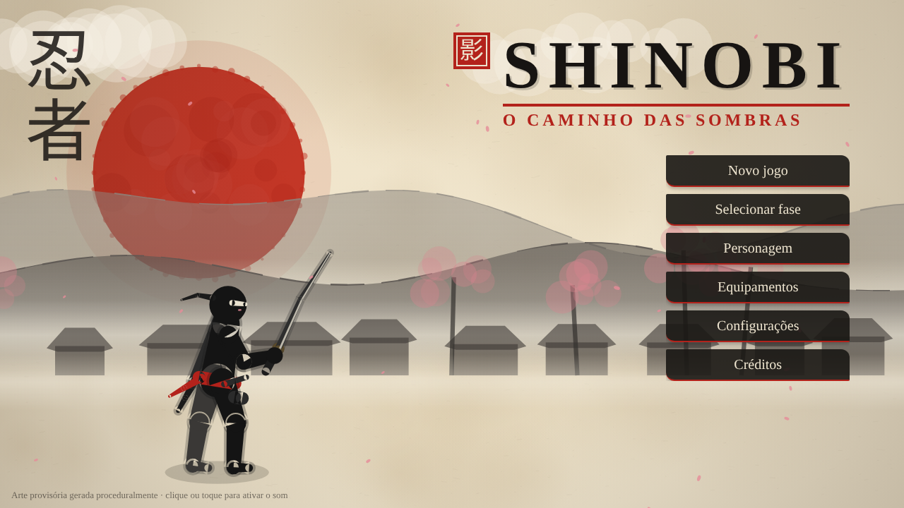
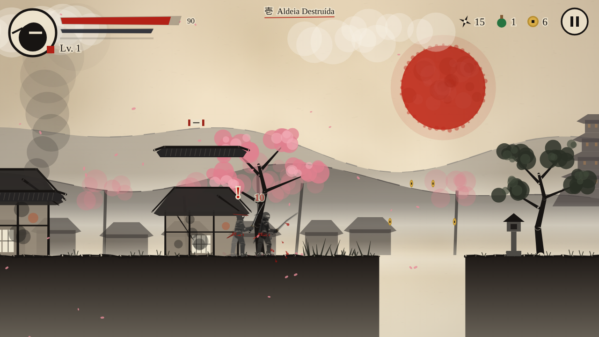
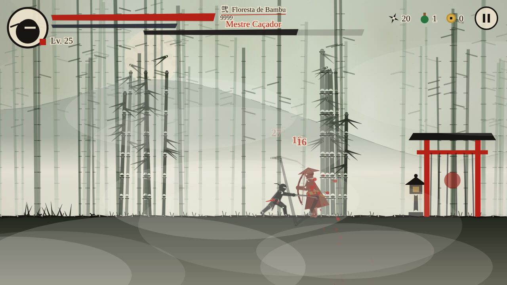
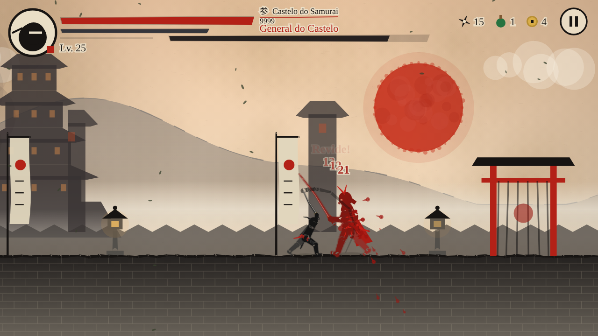
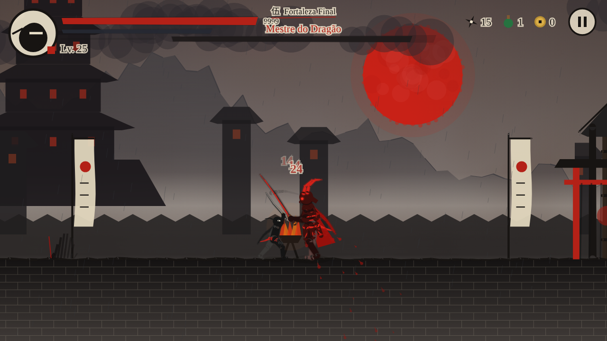
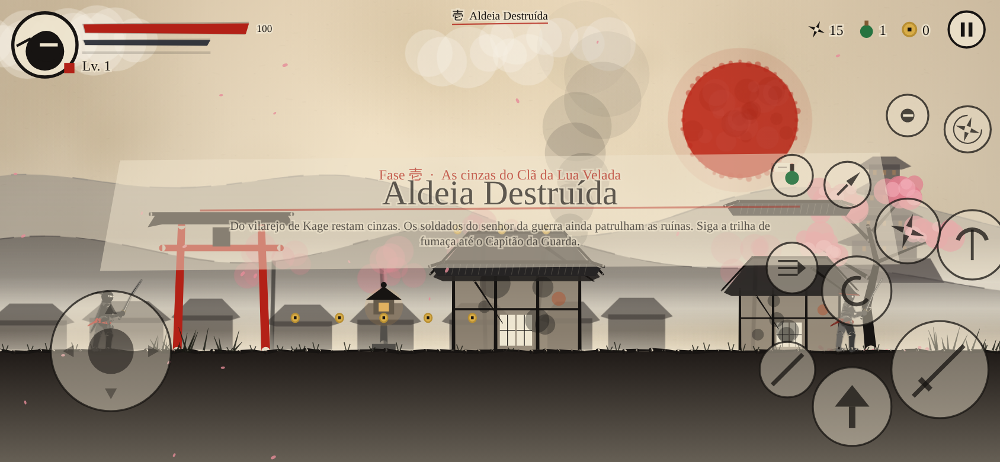

<div align="center">

# 忍 SHINOBI — O Caminho das Sombras

**Jogo de ação e plataforma ninja em 2D, no estilo sumi-e (nanquim sobre papel de arroz), que roda direto no navegador.**

Ver o jogo online: https://skylinenando.github.io/GAME-SHINOBI-O-Caminho-das-Sombras

HTML5 · Canvas 2D · Web Audio · JavaScript puro · um único arquivo `index.html`, sem dependências



</div>

---

## Índice

- [Sobre o jogo](#sobre-o-jogo)
- [Como jogar](#como-jogar)
- [Controles](#controles)
- [Conteúdo](#conteúdo)
- [Capturas de tela](#capturas-de-tela)
- [Publicar no GitHub Pages](#publicar-no-github-pages)
- [Estrutura do repositório](#estrutura-do-repositório)
- [Arquitetura do código](#arquitetura-do-código)
- [Dados do jogo (JSON)](#dados-do-jogo-json)
- [Gerar o `index.html`](#gerar-o-indexhtml)
- [Personalizar e expandir](#personalizar-e-expandir)
- [Compatibilidade](#compatibilidade)
- [Limitações conhecidas](#limitações-conhecidas)
- [Créditos e licença](#créditos-e-licença)

---

## Sobre o jogo

O jogo se passa no Japão feudal. **Kage** é o último sobrevivente do Clã da Lua Velada, destruído por um poderoso
senhor da guerra. Ele atravessa cinco territórios e enfrenta exércitos e guerreiros lendários até descobrir quem
está por trás do massacre.

- Personagens, cenários e efeitos são **desenhados por código**, com pinceladas de tinta e poses-chave interpoladas.
- A **música e os efeitos sonoros são sintetizados no próprio navegador**: koto, shakuhachi, taiko, gongo, vento e chuva.
  O jogo não usa nenhum arquivo de áudio nem imagem externa.
- O progresso é **salvo automaticamente** no navegador, no `localStorage`.

> ⚠️ **Arte provisória:** a arte é procedural e consistente, mas ainda não é a arte final.
> O código está organizado para ser trocado por spritesheets desenhados à mão
> (veja [Personalizar e expandir](#personalizar-e-expandir)).

## Como jogar

| Forma | Como |
|---|---|
| **Localmente** | Baixe o repositório e dê dois cliques em `index.html`. Não precisa de servidor. |
| **Online** | Publique no GitHub Pages (instruções [abaixo](#publicar-no-github-pages)) ou em qualquer hospedagem estática, como Netlify, Vercel ou itch.io (no itch.io, como projeto HTML). |
| **Celular** | Abra o link no navegador do celular, de preferência com o aparelho na horizontal. Os controles de toque aparecem sozinhos. |

> 🔊 Os navegadores só liberam o som depois da primeira interação. Clique ou toque na tela para ativar o áudio.

## Controles

| Ação | Teclado / Mouse | Gamepad | Toque |
|---|---|---|---|
| Mover (segurar para correr) | `A` `D` / `←` `→` | Analógico | Direcional |
| Escalar / agachar / rastejar | `W` `S` / `↑` `↓` | Analógico | Direcional ↑ ↓ |
| Deslizar | `↓` enquanto corre | Analógico ↓ | Direcional ↓ |
| Pular (duas vezes = pulo duplo) | `Espaço` | A | Botão de salto |
| Ataque leve (combo de 3 golpes) | `J` / clique esquerdo | X | Botão da katana |
| Ataque pesado (quebra a guarda) | `K` / clique direito | Y | Botão pequeno |
| Bloquear (no tempo certo = **contra-ataque**) | `L` (segurar) | RB | Botão de defesa |
| Esquiva | `Shift` | B | Botão de esquiva |
| Dash | `E` | LB | Botão pequeno |
| Shuriken / Kunai | `U` / `I` | D-pad ↑ / ↓ | Botões |
| Golpe giratório (habilidade) | `O` | R3 | Botão pequeno |
| Furtividade | `Q` | L3 | Botão pequeno |
| Elixir | `H` | Select | Botão pequeno |
| Pausa | `Esc` / `P` | Start | Botão no canto superior |

**Dicas**
- Agachar e pular ao mesmo tempo faz Kage descer de plataformas finas.
- Atacar pelas costas um inimigo que ainda não viu Kage, ou atacar em furtividade, é um **ataque furtivo**:
  inimigos comuns morrem na hora.
- Bloquear no instante exato do golpe faz um **contra-ataque**: o atacante fica atordoado e as flechas inimigas voltam contra ele.

## Conteúdo

### Kage, o protagonista
Kage tem 27 animações: parado, andar, correr, pular, pulo duplo, cair, aterrissar, agachar, rastejar, escalar,
deslizar, dash, dois ataques leves, ataque pesado, combo, giratório, bloqueio, esquiva, contra-ataque, arremesso de
shuriken, arremesso de kunai, ataque aéreo, furtividade, dano, morte e vitória.

### Os cinco inimigos principais
| Tipo | Comportamento |
|---|---|
| **Soldado Ashigaru** | Lança, espada, escudo ou naginata. Ataque frontal e defesa simples. Uma variante espalha estrepes pelo chão. |
| **Arqueiro Samurai** | Mira prevendo o movimento de Kage, recua quando ele se aproxima e procura posições elevadas. |
| **Ninja Rival** | Usa duas espadas e é rápido. Salta com ataque aéreo, esquiva, arma emboscadas e arremessa shurikens. |
| **Samurai de Elite** | Armadura pesada que resiste a golpes leves e guarda alta. Avisa antes dos golpes pesados e revida. |
| **Assassino das Sombras** | Usa corrente e foice. Some na fumaça e reaparece pelas costas de Kage para executar combos. |

Os inimigos pensam por estados: `idle`, `patrol`, `detect`, `chase`, `attack`, `defend`, `dodge`, `search`,
`hurt`, `death`, `retreat`, `stun` e `special`.

O que a inteligência deles faz:
- **Percepção:** enxergam em linha reta (paredes bloqueiam a visão) e ouvem ruídos de corrida, pouso e ataques.
- **Memória:** lembram o último lugar onde viram Kage.
- **Cooperação:** um inimigo que avista Kage alerta os aliados próximos.
- **Coordenação:** no máximo dois atacam ao mesmo tempo, e os outros cercam pelo lado oposto.
- **Retorno:** quando perdem Kage de vista, procuram por um tempo e depois voltam à patrulha.

### As cinco fases e os chefes
| # | Fase | Cenário | Chefe | Golpes especiais |
|---|---|---|---|---|
| 壱 | Aldeia Destruída | casas queimadas, pontes, cerejeiras, fumaça | **Capitão da Guarda** | investida, salto com onda de choque, chama soldados |
| 弐 | Floresta de Bambu | névoa, cachoeiras, armadilhas de estacas e de flechas | **Mestre Caçador** | rajada de flechas, chuva de flechas, estrepes |
| 参 | Castelo do Samurai | muralhas, torres com escadas, salões, telhados | **General do Castelo** | onda cortante, dash cortante, guarda com revide |
| 肆 | Templo das Sombras | escadarias, estátuas, velas, sala secreta | **Guardião do Templo** | giro de bastão, orbes que perseguem Kage, teleporte, clones |
| 伍 | Fortaleza Final | portões, torres, tempestade, lua vermelha | **Mestre do Dragão** | dragão de tinta (pule ou abaixe-se), pilares de tinta, mergulho do dragão, **3 etapas** |

### Progressão
- **Experiência e nível:** cada nível aumenta a vida, a energia e o dano de Kage.
- **Moedas e loja:**
  - 3 katanas melhores, cada uma com rastro de golpe próprio.
  - 6 técnicas: golpe giratório, kunai, leque de 3 shurikens, contra-ataque aprimorado, passo da sombra e mestre da furtividade.
  - Atributos de vida e de energia.
  - 3 trajes, cada um com um bônus.
  - Consumíveis: shurikens, kunais e elixires.
- **Fases:** checkpoints ao longo de cada fase, desbloqueio da fase seguinte e melhor tempo registrado.

## Capturas de tela

| Fase 1 — Aldeia Destruída | Floresta de Bambu — Mestre Caçador |
|---|---|
|  |  |
| **Castelo — General do Castelo** | **Fortaleza Final — Mestre do Dragão** |
|  |  |

**Celular, com controles de toque**



## Publicar no GitHub Pages

1. Crie um repositório no GitHub e envie todos os arquivos (o `index.html` precisa ficar na raiz):
   ```bash
   git init
   git add .
   git commit -m "SHINOBI — versão navegador"
   git branch -M main
   git remote add origin https://github.com/<seu-usuario>/<seu-repositorio>.git
   git push -u origin main
   ```
2. No GitHub, abra **Settings → Pages**.
3. Em **Build and deployment → Source**, escolha **Deploy from a branch**, a branch **`main`** e a pasta **`/ (root)`**, e salve.
4. Em um ou dois minutos o jogo estará em `https://<seu-usuario>.github.io/<seu-repositorio>/`.

## Estrutura do repositório

```
.
├── index.html          ← o jogo completo (gerado; é o que o navegador abre)
├── shell.html          ← modelo HTML + CSS da interface (o build injeta dados e código aqui)
├── build.py            ← junta shell.html + src/*.js + data/*.json → index.html
├── src/                ← código-fonte JavaScript (concatenado em ordem numérica)
│   ├── 01_core.js
│   ├── 02_rig.js
│   ├── 03_world.js
│   ├── 04_player.js
│   ├── 05_enemies.js
│   ├── 06_boss.js
│   ├── 07_level.js
│   ├── 08_game.js
│   └── 09_ui.js
├── data/               ← conteúdo do jogo em JSON
│   ├── characters/     animations.json · skins.json · kage.json
│   ├── enemies/        enemies.json · bosses.json
│   ├── weapons/        weapons.json · shop.json
│   └── levels/         level_1.json … level_5.json
└── docs/screenshots/   imagens deste README
```

## Arquitetura do código

O jogo não usa frameworks nem bibliotecas: só a API Canvas 2D e a Web Audio API.

| Arquivo | Responsabilidade |
|---|---|
| `01_core.js` | Funções utilitárias e cores. Entrada de teclado, gamepad e toque. **Sintetizador de áudio** (efeitos, ambiente e 9 músicas). Salvamento (`Save`) e progressão (`Prog`: XP, moedas, loja, inventário). |
| `02_rig.js` | **Rig de tinta**: interpola as poses-chave e calcula o esqueleto (quadril, tronco, cabeça, braços, pernas, arma). Desenha com pinceladas cônicas e "sangramento" da tinta. Classe `Figure`: animação, eventos sincronizados com os quadros (`hit`, `throw`, `shoot`) e rastro da lâmina. |
| `03_world.js` | Física e colisão por caixas, incluindo plataformas finas que dão para atravessar por baixo, linha de visão e detecção de chão. Fundo de papel e camadas de parallax pré-renderizadas, terreno, ~25 tipos de cenário, clima, efeitos de tinta, projéteis, perigos, coletáveis e objetos da fase. |
| `04_player.js` | **Kage**: estados de movimento e combate, golpes com áreas de acerto ativadas no quadro certo, combo com cancelamento, contra-ataque, furtividade, energia e invulnerabilidade. |
| `05_enemies.js` | Classe `Enemy` com os estados de IA, percepção e coordenação dos ataques. Subclasses dos cinco tipos: `Ashigaru`, `Archer`, `RivalNinja`, `EliteSamurai` e `ShadowAssassin`. |
| `06_boss.js` | Classe `Boss`: etapas por porcentagem de vida. Cada golpe especial é uma **corrotina** (`function*`): `yield 0.5` espera meio segundo e `yield 0` espera um quadro. A corrotina é cancelada em caso de atordoamento ou troca de etapa. |
| `07_level.js` | Classe `Level`: monta a fase a partir do JSON, controla câmera, arena do chefe, ruídos, alertas, checkpoints, vitória e derrota. |
| `08_game.js` | Laço principal com **passo fixo de 60 Hz**, escala para qualquer tela, hit-stop, tremor de câmera, HUD em canvas, controles de toque com vários dedos ao mesmo tempo e a cena animada do menu. |
| `09_ui.js` | Interface em HTML: menu, seleção de fase, personagem, loja, configurações, créditos, pausa, vitória e derrota. Pausa automática quando a aba fica oculta. |

### Convenções do rig de animação
Cada animação em `data/characters/animations.json` é uma lista de poses-chave com ângulos em graus:

| Chave | Significado |
|---|---|
| `a1`/`a2`, `b1`/`b2` | Braço da frente e de trás (segmento superior absoluto, antebraço relativo) |
| `l1`/`l2`, `k1`/`k2` | Perna da frente e de trás |
| `t`, `h` | Inclinação do tronco e da cabeça |
| `w`, `w2` | Ângulo da arma em relação ao antebraço |
| `rot` | Rotação do corpo inteiro (cambalhotas) |
| `air` | `1` = a figura não é encostada no chão (usado no ar) |
| `tr` | `1` = desenha o rastro da lâmina |
| `ev` | Evento disparado ao entrar no quadro: `hit`, `throw`, `shoot`, `spark`, `cast` |

Referência dos ângulos: `0` = para baixo, `90` = para frente, `180` = para cima e `-90` = para trás.

## Dados do jogo (JSON)

Todo o conteúdo pode ser editado sem mexer no código:

- **`characters/skins.json`**: aparência de cada personagem (cores, tipo de cabeça, armadura, arma, escala, capa, lenço).
- **`characters/kage.json`**: atributos de Kage (velocidades, gravidade, pulo, custos de energia, dano de cada golpe, janela de contra-ataque).
- **`enemies/enemies.json`**: os 26 inimigos. Cada um tem tipo, vida, velocidade, visão, tempo de reação, agressividade, defesa, esquiva, armadura, resistência a interrupção, XP, moedas e lista de ataques (área de acerto, dano, alcance, empurrão).
- **`enemies/bosses.json`**: chefes, com a vida em que cada etapa começa, golpes sorteados por peso, intervalo entre ataques e multiplicadores de dano e velocidade.
- **`weapons/shop.json`**: itens da loja (tipo, custo, pré-requisito, efeito).
- **`levels/level_N.json`**: fase completa.

Os campos de cada fase:

| Campo | Conteúdo |
|---|---|
| `ground` | Trechos de chão; os intervalos entre eles são abismos |
| `blocks` | Blocos sólidos |
| `platforms` | Plataformas finas e pontes |
| `ladders` | Escadas |
| `hazards` | Estacas |
| `traps` | Armadilhas de flechas |
| `secrets` | Salas secretas |
| `enemies` | Inimigos, com área de patrulha |
| `checkpoints` | Pontos de salvamento |
| `pickups` | Itens no chão |
| `decor`, `front_decor` | Cenário atrás e na frente dos personagens |
| `boss` | Chefe, com a arena, a fala de entrada e a de derrota |
| `exit` | Saída da fase |
| `story` | Texto de abertura da fase |
| `music`, `weather` | Música e clima |

Coordenadas: o chão fica em `y = 0` e valores negativos de `y` ficam acima dele.

## Gerar o `index.html`

O `index.html` é **gerado**. Depois de editar `src/`, `data/` ou `shell.html`, rode:

```bash
python3 build.py
```

Isso exige apenas Python 3, sem bibliotecas extras. O script coloca todos os JSON e o código num único arquivo HTML que funciona offline.

Durante o desenvolvimento, abra `index.html` no navegador e recarregue a página a cada novo build.
O objeto `window.__SHINOBI` (`Game`, `Prog`, `Save`, `Input`) fica exposto para depuração no console. Por exemplo:

```js
__SHINOBI.Prog.newGame(); __SHINOBI.Game.startLevel(5);   // vai direto para a fase final
__SHINOBI.Save.data.coins = 5000;                        // moedas para testar a loja
```

## Personalizar e expandir

- **Nova fase:** crie `data/levels/level_6.json`. Depois aumente o limite de 5 fases em `07_level.js`/`09_ui.js`
  (`Math.min(n + 1, 5)`, a lista de chefes no seletor de fases e o laço `n <= 5`) e no `build.py`.
- **Novo inimigo:** adicione uma entrada em `enemies.json` com um tipo existente e uma aparência em `skins.json`.
  Para um comportamento novo, crie uma subclasse de `Enemy` e registre-a em `ARCHETYPES` (`05_enemies.js`).
- **Novo golpe de chefe:** crie um método gerador `*mv_nome()` em `Boss` e use `"nome"` no campo `moves` da etapa, em `bosses.json`.
- **Arte final:** substitua `Figure.draw` (`02_rig.js`) por um desenho a partir de spritesheets, mantendo
  `rigSample` para os eventos de golpe continuarem sincronizados. O cenário fica em `DECOR` (`03_world.js`).
- **Áudio próprio:** troque `Synth.music` e `Synth.sfx` por buffers carregados de arquivos `.ogg` via `AudioContext.decodeAudioData`.

## Compatibilidade

- **Navegadores:** Chrome/Edge 90+, Firefox 90+ e Safari 14+, no computador e no celular.
- **Telas:** qualquer resolução. A área de jogo tem 720 px de altura lógica e a largura se adapta à proporção da tela.
- **Gamepad:** padrão "standard" (Xbox/PlayStation) pela Gamepad API. Ele é desativado sozinho quando a página
  roda num iframe sem permissão para gamepad.
- **Desempenho:** passo de simulação fixo em 60 Hz. Inimigos distantes e desatentos ficam "dormindo" para economizar processamento.

## Limitações conhecidas

- Arte e animações são provisórias (procedurais).
- O salvamento fica no `localStorage` do navegador. Limpar os dados do site, usar uma aba anônima ou trocar de
  navegador ou aparelho começa um jogo novo.
- Os degraus das escadarias são blocos sólidos e precisam de pequenos saltos; não há rampas.
- O balanceamento de vida e dano é inicial e pode ser ajustado nos JSON.

## Créditos e licença

- Design, programação, IA, fases, interface, efeitos e áudio: equipe do projeto **SHINOBI — O Caminho das Sombras**.
- Toda a arte e todo o som são gerados por código; o projeto não usa nenhum recurso de terceiros.
- **Licença:** defina a licença do repositório (por exemplo, MIT) adicionando um arquivo `LICENSE`.

<div align="center">

影は消えない — *a sombra não desaparece.*

</div>
